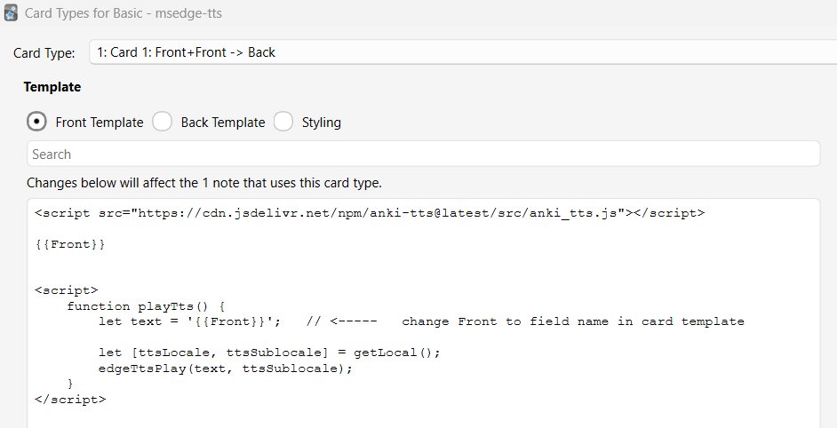
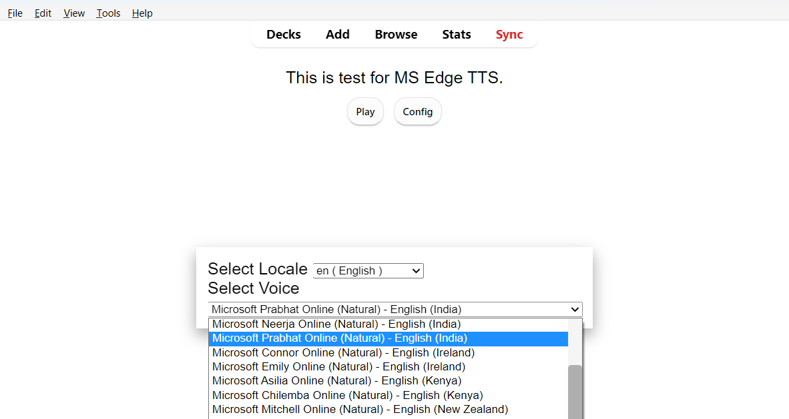

# Anki TTS

Text-to-speech in Anki card templates. Two engines, switchable at review time:

- **Microsoft Edge** — online, wide voice selection (the original engine). Microsoft's
  server only accepts this connection from the real Microsoft Edge browser, so it fails
  everywhere else (Chrome, Firefox, Safari, and Anki's own review window) unless the
  [local relay](#edge-tts-outside-microsoft-edge) below is running.
- **Piper** — offline, on-device neural TTS, works in any browser. Voices are downloaded
  on first use from [rhasspy/piper-voices](https://huggingface.co/rhasspy/piper-voices)
  and cached in the browser, so review works without a network connection after that.

### Usage

Add following script tag at top in Anki Card Template using note editor.

```html
<script type="module" src="https://cdn.jsdelivr.net/gh/krmanik/anki-tts@latest/src/anki_tts.js"></script>
```

Then update the `playTts` method, change `{{Front}}` to field name. Lets say if field name in note type is Hanzi, then replace it with `{{Hanzi}}`. Copy following method to Card template.

```html
<script>
    stopTts?.();               // stop any audio left playing from the previous card

    function playTts() {
        let text = '{{Front}}';   // <-----   change Front to field name in card template
        ttsPlay(text);             // uses whichever engine/voice is selected in Settings
    }
</script>
```

Click Settings during review to pick an engine (Edge or Piper), locale and voice — for
Piper, pick a speaker too if the voice has more than one. Then click Play; the button
turns into Pause/Resume while audio is playing, with a Stop button and a progress bar
next to it.

The `stopTts?.()` line matters: Anki re-runs this inline `<script>` block on every card,
so it reliably stops whatever the *previous* card was saying the instant the next one
loads — without it, a long sentence you didn't wait out can keep playing over the next
card. `ttsPlay()` also stops previous audio itself when *you* click Play again, so that
part works either way; `stopTts?.()` is what covers advancing without clicking anything.

The first play with a given Piper voice downloads its model (10-70MB depending on
quality); later plays are instant. A collapsible Log section at the bottom of Settings
shows every step (voice list, download progress, phonemes, synthesis) and auto-expands
on error — handy since Anki's reviewer has no easy devtools access.

If you need to call a specific engine directly instead of the saved selection, both
`edgeTtsPlay(text, voice)` and `piperTtsPlay(text, voiceKey)` are available too.





### Edge TTS outside Microsoft Edge

Microsoft's Edge TTS endpoints check the browser's real `User-Agent` header and reject
everything but actual Microsoft Edge — browsers forbid JS from overriding that header, so
this can't be fixed client-side, in this library or any other, in any browser (including
Anki's own review window). `npm run relay` gets around this by making the connection from
outside the browser sandbox, in Node on your own machine, where custom headers are legal:

```bash
npm run build:relay
npm run relay   # listens on http://127.0.0.1:8811, localhost only
```

Leave it running while you review; the Edge engine detects it automatically and uses it
instead of the direct (Edge-only) connection. No relay running just means Edge TTS falls
back to "real Edge browser only," same as before — everything else is unaffected.

### Development

TypeScript sources live in `src-ts/`; `npm run build` compiles them to `src/` with `tsc`
(plain ES modules, no bundler) — `src/anki_tts.js` is the file the script tag above loads,
so its path never changes.

To test a change in Anki before pushing to GitHub/npm:

```bash
npm run build
npm run serve   # serves this repo at http://127.0.0.1:8934/
```

Then in the Anki card template, temporarily point the script tag at your local build
instead of jsDelivr:

```html
<script type="module" src="http://127.0.0.1:8934/src/anki_tts.js"></script>
```

Review some cards, check the Log panel in Settings for errors, and switch the `src` back
to the jsDelivr URL once it looks right. `npm run watch` recompiles on save if you're
iterating; just reload the card in Anki after each change (no server restart needed).

## Credits

- [Migushthe2nd/MsEdgeTTS: A simple Azure Speech Service module that uses the Microsoft Edge Read Aloud API](https://github.com/Migushthe2nd/MsEdgeTTS)
- [JS port of https://github.com/Migushthe2nd/MsEdgeTTS](https://gist.github.com/likev/c36fcc8a08ba1a2c5d08f9c7d806a0ad)
- [KingDanx/edge-tts-browser: edge tts file creation in browser](https://github.com/KingDanx/edge-tts-browser)
- [rhasspy/piper: A fast, local neural text to speech system](https://github.com/rhasspy/piper)
- [rhasspy/piper-voices on Hugging Face](https://huggingface.co/rhasspy/piper-voices)
- [ken107/piper-browser-extension: espeak-ng-wasm phonemizer + ONNX Runtime Web wiring this project's Piper engine is based on](https://github.com/ken107/piper-browser-extension)
